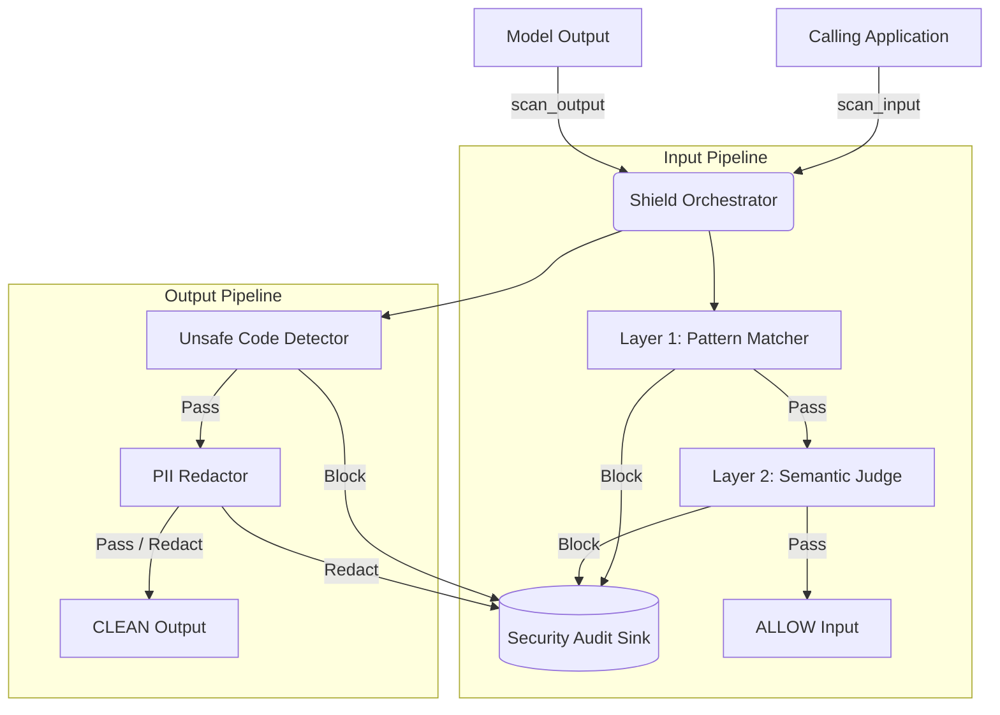
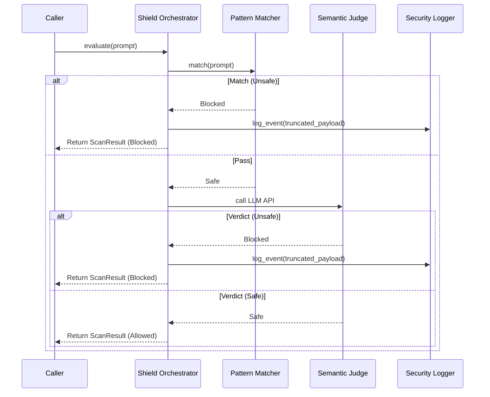

# HLD: LLMShield — AI Security Gateway
- **Links:** [Requirements](https://github.com/msanchit-dev/llm-shield/blob/main/docs/requirements.md)

## 1. Context, Scope & System Boundaries

### 1.1 Context & Business Problem
Generative AI applications are vulnerable to prompt manipulation (direct instruction overrides, jailbreaks, hidden prompt extraction) and unintended data leakage (PII, API credentials, unsafe code generation). LLMShield provides an in-process security middleware that inspects prompts before they reach an LLM and sanitizes model outputs before they reach the user.

### 1.2 Scope & Principles
- **In Scope:**
  - Two-tier input inspection: fast pattern-matching followed by an LLM-as-a-Judge semantic classifier.
  - Direct protection for four primary risks from the *OWASP Top 10 for LLM Applications (2026 Edition)*: `LLM01` (Prompt Injection), `LLM02` (Sensitive Information Disclosure), `LLM08` (Hidden Context Exposure), and `LLM10` (Improper Output Handling).
  - Output sanitization (masking sensitive data and blocking unsafe code execution).
  - Debug-friendly security audit logging with inline redaction and payload truncation.
- **Out of Scope:** Multi-turn conversational session tracking, custom model training, non-text modalities (audio/image), and network-level DDoS/rate-limiting (`LLM06`).
- **Key Architectural Principles:**
  - **Short-Circuit Execution:** Fast local pattern evaluations run first; expensive LLM Judge calls only execute if the fast path passes.
  - **Config-Driven Extensibility:** All detection rules and redaction patterns live in an external configuration file.
  - **Fail-Closed Security:** System timeouts, API outages, or unexpected exceptions default to blocking the input.

## 2. System Architecture & Execution Flow

### 2.1 System Topology

### 2.2 Subsystem & Component Inventory

| Subsystem / Component | Stack / Runtime | Primary Responsibility | State / Dependency |
| :--- | :--- | :--- | :--- |
| **Shield Orchestrator** | Python Runtime | Central gateway coordinating the input and output inspection pipelines. | Stateless |
| **Configuration Engine** | YAML Parser | Reads, validates, and pre-compiles security rules from external configuration. | Local File System |
| **Pattern Matcher (L1)** | Regex Engine | Fast-path pattern matching for prompt injection (`LLM01`) and context exposure (`LLM08`). | Stateless (Pre-compiled) |
| **Semantic Judge (L2)** | LLM Adapter | Semantic evaluation for obfuscated jailbreak attacks via few-shot prompts. | External LLM API |
| **Output Sanitizer** | Regex Engine | Scans LLM responses to mask PII/secrets (`LLM02`) and block unsafe code snippets (`LLM10`). | Stateless |
| **Security Audit Logger** | CSV Writer | Records flagged inputs and sanitized outputs for developer auditing. | Local File System |

### 2.3 Critical Path Sequence

## 3. Data Flow, Contracts & State Model

### 3.1 Synchronous & Asynchronous Contracts

| Flow Name | Producer / Caller | Consumer / Target | Protocol / Interface | Key Payload / Schema | Timeout / SLA | Failure / Fallback Policy |
| :--- | :--- | :--- | :--- | :--- | :--- | :--- |
| **Scan Input** | Calling App | Shield Orchestrator | In-Process API | Input: Raw text string. Output: Safety verdict flag, rule category ID, explanation, latency. | L1: < 1ms; L2: < 2s | Fail-closed (block input on LLM error or timeout). |
| **Scan Output** | Calling App | Shield Orchestrator | In-Process API | Input: Raw model response. Output: Safety verdict flag, cleaned text, rule category ID, latency. | < 5ms | Fail-closed on unsafe code; redact and allow on PII. |
| **Audit Event** | Shield Orchestrator | Security Logger | File Append | Timestamp, truncated & masked text snippet, safety status, rule category, latency. | < 1ms | Drop silently with standard error logging on disk error. |
| **LLM Evaluation** | Semantic Judge | External LLM Adapter | Provider Interface | System prompt + delimiter-wrapped user text -> structured JSON verdict. | < 2s | Fail-closed on malformed response or transport error. |

### 3.2 State, Configuration & Storage Model
- **Configuration & Rules Management:** Rules are defined in an external declarative YAML configuration file. Patterns are pre-compiled at application initialization to catch syntax errors early.
- **In-Memory State & Lifecycle:** Scanners remain strictly stateless during request execution, keeping memory consumption low (< 50 MB) and predictable.
- **Audit Storage:** Flagged security events are recorded to a local CSV audit sink. Logged text is truncated to 100 characters and processed with an inline scrubber to mask emails and API keys to prevent sensitive data leaks.

## 4. Capacity, Security & Operations

### 4.1 Capacity, Resource & Cost Estimates

| Metric | Baseline / Target | Notes & Assumptions |
| :--- | :--- | :--- |
| **Throughput (Layer 1)** | > 1,000 scans/sec | Fast-path pattern matching runs locally in sub-millisecond time. |
| **Throughput (Layer 2)** | Bound by LLM Provider | Bound by external LLM API rate limits and network latency. |
| **Compute & Memory** | < 50 MB RAM | In-process execution with no background daemon processes. |
| **Storage Growth** | ~150 bytes / event | Lightweight CSV records; clean prompts are not logged. |

### 4.2 Non-Functional Specifications

| Dimension | Specification & Mitigations |
| :--- | :--- |
| **Resiliency & Fault Tolerance** | **Fail-Closed Design:** Network timeouts, model API rate limits, or malformed responses automatically mark the input as unsafe. |
| **Security & Threat Model** | **ReDoS Mitigation:** Regular expressions are kept simple, non-backtracking, and bound to reasonable input lengths. |
| **Observability** | **Latency & Reason Tracking:** Every scan returns fine-grained execution latency and human-readable trigger reasons. |
| **Quality Assurance** | **Deterministic Testing:** 100% unit test coverage for pattern rules, edge cases, and mocked LLM Judge interactions. |

## 5. Risks & Mitigations

| ID | Risk Description | Impact / Severity | Mitigation Plan |
| :--- | :--- | :--- | :--- |
| **R-01** | Upstream Semantic Judge API latency spikes or times out. | High (Availability) | Enforce a strict 2-second timeout and fail closed with a clear diagnostic message. |
| **R-02** | ReDoS vulnerability from nested greedy quantifiers in user-supplied regex rules. | Medium (Performance) | Restrict pattern complexity in configuration, validate patterns at startup, and enforce input text length limits. |
| **R-03** | Over-blocking legitimate user prompts discussing cybersecurity or programming concepts. | Medium (User Experience) | Use the 40-case benchmark suite to tune pattern precision and LLM Judge few-shot examples. |
| **R-04** | File locking contention or permission failures when writing to the local audit CSV. | Low (Observability) | Keep CSV file writes synchronous, wrap file operations in exception handlers, and fail open on logging errors. |

## 6. Open Questions

| ID | Open Question | Context / Options | Pending Resolution Path |
| :--- | :--- | :--- | :--- |
| **Q-01** | Should Layer 2 Semantic Judge execution be optional via configuration for local-only deployments? | Some users may want to run LLMShield without external API dependencies or costs (regex-only mode). | Provide an enable/disable flag in configuration or allow omitting the LLM adapter during initialization. |
| **Q-02** | What default character length limit should be enforced on prompts before scanning? | Scanning extremely long documents through regex or LLM Judge can cause latency degradation. | Define a sensible default limit (e.g., 4,000 characters) in the configuration loader. |
