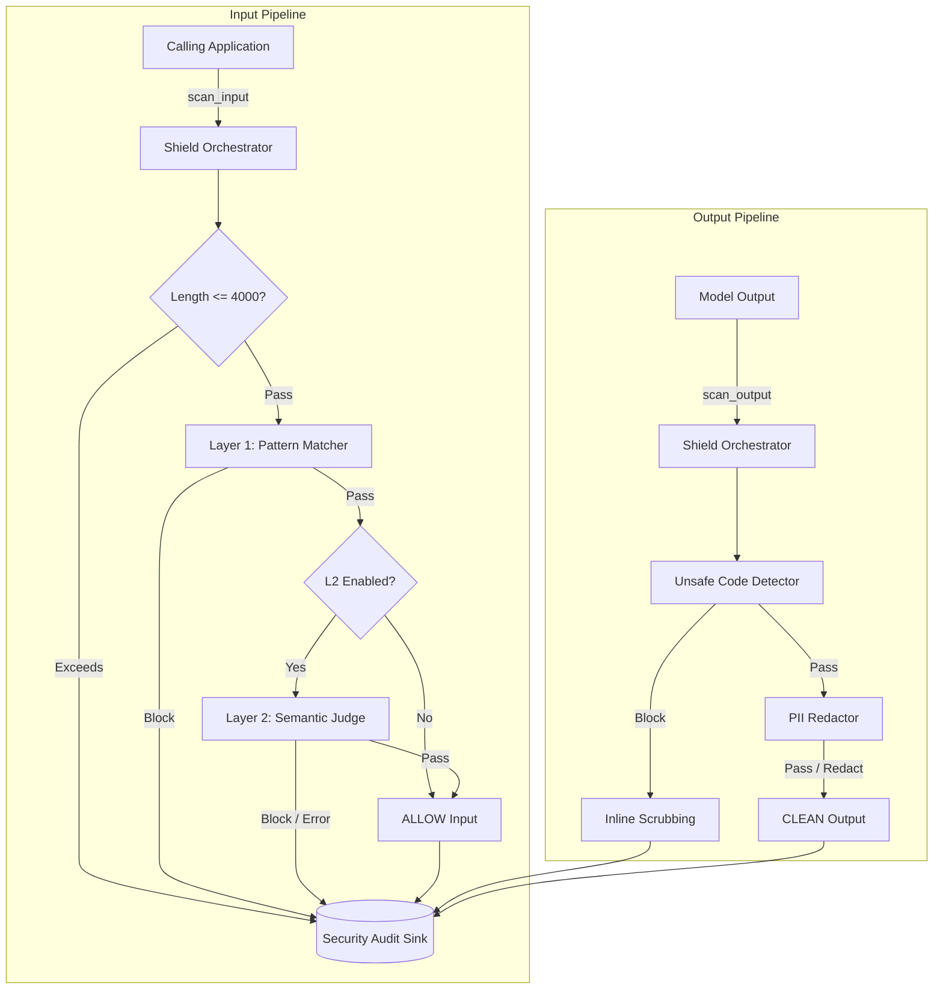
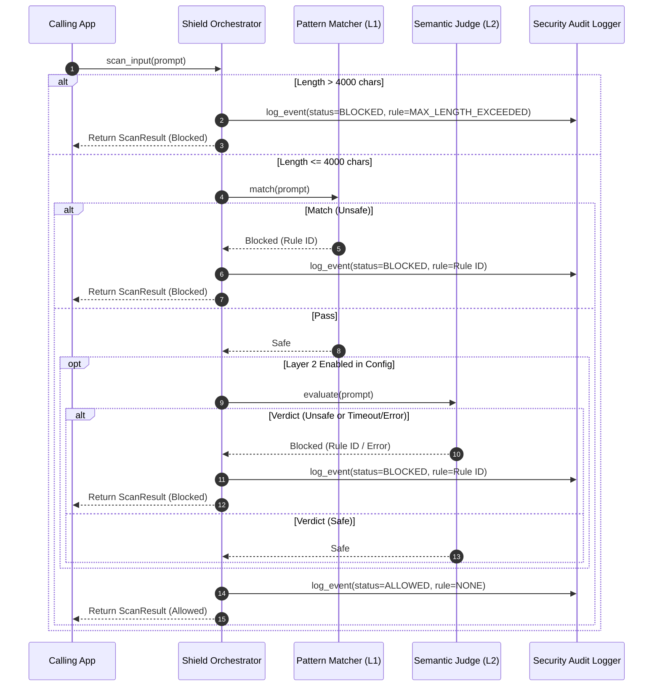

# HLD: LLMShield — AI Security Gateway

* **Links:** [Requirements](./requirements.md)

---

## 1. Context, Scope & System Boundaries

### 1.1 Context & Business Problem
Generative AI applications are vulnerable to prompt manipulation (direct instruction overrides, jailbreaks, hidden prompt extraction) and unintended data leakage (PII, API credentials, unsafe code generation). LLMShield provides an in-process security middleware that inspects prompts before they reach an LLM and sanitizes model outputs before they reach the user.

### 1.2 Scope & Principles
* **In Scope:**
  * Input length validation (default 4,000-character limit) and two-tier input inspection: fast pattern-matching followed by an optional LLM-as-a-Judge semantic classifier.
  * Direct protection for four primary risks from the *OWASP Top 10 for LLM Applications (2026 Edition)*: `LLM01` (Prompt Injection), `LLM02` (Sensitive Information Disclosure), `LLM08` (Hidden Context Exposure), and `LLM10` (Improper Output Handling).
  * Output sanitization (masking sensitive data and blocking unsafe code execution).
  * Complete security audit logging (covering clean, redacted, and blocked requests) with inline redaction and payload truncation.
* **Out of Scope:** Multi-turn conversational session tracking, custom model training, non-text modalities (audio/image), and network-level DDoS/rate-limiting (`LLM06`).
* **Key Architectural Principles:**
  * **Short-Circuit Execution:** Fast local length and pattern evaluations run first; expensive LLM Judge calls only execute if the fast path passes (and when enabled).
  * **Config-Driven Extensibility:** All detection rules, character limits, feature flags, and redaction patterns live in an external configuration file.
  * **Fail-Closed Security:** Input length violations, system timeouts, API outages, or unexpected exceptions default to blocking the input and logging the error.

---

## 2. System Architecture & Execution Flow

### 2.1 System Topology

### 2.2 Subsystem & Component Inventory

#### Shield Orchestrator

* **Runtime & State:** Python Runtime | Stateless
* **Responsibility:** Acts as the central gateway coordinating the input and output inspection pipelines. It enforces pre-validation constraints (blocking inputs exceeding the 4,000-character limit), executes short-circuit evaluation across inspection layers, and ensures every transaction (clean, redacted, or blocked) is emitted to the audit logger.

#### Configuration Engine

* **Runtime & State:** YAML Parser | Local File System (Startup)
* **Responsibility:** Reads and validates declarative security rules, character limits (`max_input_chars: 4000`), and feature flags (`enable_semantic_judge`) from an external YAML file. Pre-compiles regular expressions at initialization to fail fast on syntax errors.

#### Pattern Matcher (Layer 1)

* **Runtime & State:** Regex Engine | Stateless (Pre-compiled)
* **Responsibility:** Executes sub-millisecond fast-path checks against known attack signatures for Prompt Injection (`LLM01`) and Hidden Context Exposure (`LLM08`).

#### Semantic Judge (Layer 2)

* **Runtime & State:** External LLM Adapter | Stateless (Optional)
* **Responsibility:** Evaluates prompts that pass Layer 1 using few-shot classification prompts to detect obfuscated jailbreaks and semantic manipulation. Can be disabled via configuration for zero-dependency local development.

#### Output Sanitizer

* **Runtime & State:** Regex Engine | Stateless
* **Responsibility:** Inspects model outputs prior to user delivery. Blocks responses containing unsafe executable code snippets (`LLM10`) and masks sensitive PII and API credentials in-place (`LLM02`).

#### Security Audit Logger

* **Runtime & State:** CSV Writer | Local File System
* **Responsibility:** Records a complete audit trail of all processed inputs and outputs (clean, redacted, and blocked). Applies inline scrubbing (masking emails and API keys) and truncates payloads to 100 characters before persisting to disk.

### 2.3 Critical Path Sequence

---

## 3. Data Flow, Contracts & State Model

### 3.1 Synchronous & Asynchronous Contracts

#### Scan Input (`scan_input`)

* **Caller -> Target:** Calling Application -> Shield Orchestrator (In-Process API)
* **Contract:** Accepts a raw prompt string. Returns a structured `ScanResult` containing the safety verdict (`allow`/`block`), triggered rule category ID, diagnostic explanation, and execution latency.
* **SLA & Fallback:** `< 1ms` (Layer 1) and `< 2s` (Layer 2). Enforces a strict 4,000-character ceiling; inputs exceeding this limit or encountering upstream LLM timeouts fail closed (blocked) and log an error.

#### Scan Output (`scan_output`)

* **Caller -> Target:** Calling Application -> Shield Orchestrator (In-Process API)
* **Contract:** Accepts the raw model response string. Returns a `ScanResult` containing the safety verdict, the sanitized/redacted text string, triggered rule category ID, and execution latency.
* **SLA & Fallback:** `< 5ms`. Fails closed (blocks output) if unsafe code (`LLM10`) is detected; masks inline and allows output if PII/secrets (`LLM02`) are detected.

#### LLM Semantic Evaluation (`evaluate`)

* **Caller -> Target:** Semantic Judge -> External LLM Adapter (Provider Interface)
* **Contract:** Wraps user input in security delimiters alongside a system classification prompt, expecting a structured JSON safety verdict.
* **SLA & Fallback:** `< 2s` strict timeout. Fails closed on network timeout, rate-limit error, or malformed JSON response. Bypassed entirely if `enable_semantic_judge` is set to `false` in configuration.

#### Audit Event Logging (`log_event`)

* **Caller -> Target:** Shield Orchestrator -> Security Audit Logger (File Append)
* **Contract:** Invoked unconditionally on every `scan_input` and `scan_output` call (clean, redacted, and blocked). Writes timestamp, event type, safety status, rule category ID, latency, and a scrubbed, 100-character truncated payload snippet.
* **SLA & Fallback:** `< 1ms`. Fails open (drops log entry and emits warning to `stderr`) if disk write errors occur so application execution is not crashed by observability failures.

### 3.2 State, Configuration & Storage Model

* **Configuration & Rules Management:** Rules and operational limits (`max_input_chars: 4000`, `enable_semantic_judge: true/false`) are defined in an external declarative YAML configuration file. Patterns are pre-compiled at application initialization to catch syntax errors early.
* **In-Memory State & Lifecycle:** Scanners remain strictly stateless during request execution, keeping memory consumption low (`< 50 MB`) and predictable.
* **Audit Storage:** All scan events (clean, redacted, and blocked) are recorded to a local CSV audit sink. Logged text is truncated to 100 characters and processed with an inline scrubber to mask emails and API keys prior to disk write to prevent sensitive data leaks.

---

## 4. Capacity, Security & Operations

### 4.1 Capacity, Resource & Cost Estimates

| Metric | Baseline / Target | Notes & Assumptions |
| --- | --- | --- |
| **Throughput (Layer 1)** | `> 1,000 scans/sec` | Fast-path length check and pattern matching run locally in sub-millisecond time. |
| **Throughput (Layer 2)** | Bound by LLM Provider | Bound by external LLM API rate limits and network latency (skipped when disabled in local mode). |
| **Compute & Memory** | `< 50 MB RAM` | In-process execution with no background daemon processes. |
| **Storage Growth** | `~150 bytes / scan` | All prompts and outputs (clean, redacted, and blocked) are logged (~15 MB per 100,000 scans). |

### 4.2 Non-Functional Specifications

| Dimension | Specification & Mitigations |
| --- | --- |
| **Resiliency & Fault Tolerance** | **Fail-Closed Design:** Input length violations, network timeouts, model API rate limits, or malformed responses automatically mark the input as unsafe. |
| **Security & Threat Model** | **ReDoS Mitigation:** Inputs are capped at 4,000 characters prior to regex evaluation; regular expressions are kept simple and non-backtracking. |
| **Observability** | **Complete Audit & Latency Tracking:** Every scan (clean or flagged) logs fine-grained execution latency, verdict status, and human-readable trigger reasons. |
| **Quality Assurance** | **Deterministic Testing:** 100% unit test coverage for length boundaries, pattern rules, edge cases, and mocked LLM Judge interactions. |

---

## 5. Risks & Mitigations

| ID | Risk Description | Impact / Severity | Mitigation Plan |
| --- | --- | --- | --- |
| **R-01** | Upstream Semantic Judge API latency spikes or times out. | High (Availability) | Enforce a strict 2-second timeout and fail closed with a clear diagnostic message. Support disabling Layer 2 via configuration for local development. |
| **R-02** | ReDoS vulnerability from nested greedy quantifiers in user-supplied regex rules. | Medium (Performance) | Enforce a strict 4,000-character input limit prior to scanning (blocking and logging violations), validate patterns at startup, and avoid backtracking quantifiers. |
| **R-03** | Over-blocking legitimate user prompts discussing cybersecurity or programming concepts. | Medium (User Experience) | Use the 40-case benchmark suite to tune pattern precision and LLM Judge few-shot examples. |
